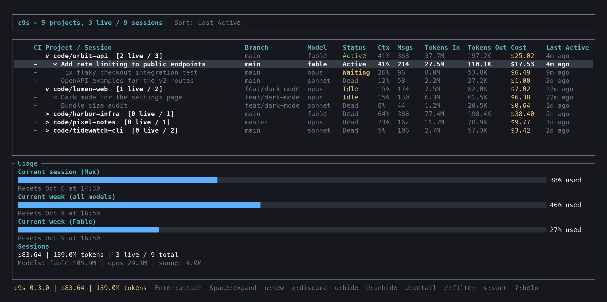
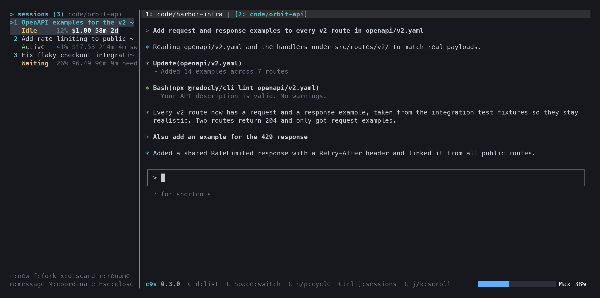

# c9s

A k9s-inspired terminal UI for Claude Code. Run many Claude Code sessions side by side, several per project, switch between them with a keystroke, and see context fill, cost and plan usage without leaving the terminal.





## Features

- **Every session, grouped by project.** All transcripts under `~/.claude/projects/` are listed, grouped into collapsible project rows with live counts, summed cost and tokens.
- **Embedded terminals.** Attaching resumes a session in a PTY inside c9s. Each project gets a tab, and a tab can hold any number of sessions of that project (`name [current/total]`).
- **Session pane** (`Ctrl+]`). Switch, create, fork, discard, rename and message the sessions of the current project without leaving the terminal.
- **Quick switcher** (`Ctrl+Space`). Jump to any project or session from anywhere.
- **Live status.** Active, Waiting (with the reason, for example `approve Bash`), Idle and Dead, read from the Claude Code session registry. Background sessions ring the terminal bell and mark their tab with `*` (turn finished) or `!` (needs input).
- **Metrics per session, project and total.** Context window fill, tokens, compactions, API errors and cost with correct 5 minute and 1 hour cache write pricing.
- **Plan usage.** The 5-hour, weekly and per-model weekly limits of your Claude subscription, as bars on the list page and a meter in the terminal status line.
- **Keep-warm** (`Ctrl+q`). Keeps the 1 hour prompt cache of a session alive while you are away, so resuming a large context does not pay for a full cache rewrite.
- **Safe take-over.** Attaching a session that runs in another terminal asks before stopping that process, or forks instead.
- **Side shell** (`Ctrl+t`) next to the session, plus a config tree viewer and a transcript picker in the detail view.

## Install

### Prebuilt binaries

Download the archive for your platform from the [latest release](https://github.com/waxb/c9s/releases/latest):

| Platform | Archive |
|---|---|
| macOS, Apple silicon | `c9s-aarch64-apple-darwin.tar.gz` |
| macOS, Intel | `c9s-x86_64-apple-darwin.tar.gz` |
| Linux, x86_64 | `c9s-x86_64-unknown-linux-gnu.tar.gz` |

```sh
tar xzf c9s-aarch64-apple-darwin.tar.gz
mv c9s ~/.local/bin/
```

On macOS, a binary downloaded through a browser is quarantined. Clear the flag once:

```sh
xattr -d com.apple.quarantine ~/.local/bin/c9s
```

### With cargo

```sh
cargo install --git https://github.com/waxb/c9s --tag v0.3.0 --locked
```

### From source

```sh
git clone https://github.com/waxb/c9s.git
cd c9s
cargo build --release
./target/release/c9s
```

## Requirements

- macOS or Linux.
- Claude Code CLI on `PATH`. c9s is tested with 2.1.263 to 2.1.278. Live status, session names and the waiting reason need a version that writes the session registry under `~/.claude/sessions/`. Older versions fall back to matching running `claude` processes by working directory.
- Rust 1.86 or newer to build. That is the floor set by the dependencies. Development happens on 1.96.
- Optional: the GitHub CLI (`gh`), logged in, for the CI column.

## Getting started

1. Run `c9s`. The list shows every project that has Claude Code transcripts, most recent first.
2. Press `Space` on a project to expand it into its sessions.
3. Press `Enter` on a session to attach. c9s runs `claude --resume <id>` inside a tab.
4. Press `Ctrl+]` to open the session pane, then `n` to start another session in the same project.
5. Press `Ctrl+d` to go back to the list. Attached sessions keep running in the background.

## Keybindings

### List view

| Key | Action |
|---|---|
| `j` / `k`, arrows | Move |
| `g` / `G` | Top / bottom |
| `Space` | Expand or collapse the project |
| `l` / `h`, Right / Left | Expand / collapse |
| `Enter` / `a` | Attach (on a project row: its current session) |
| `1`-`9` | Attach the current session of the Nth project |
| `Ctrl+Space` | Quick switcher |
| `n` | New session: directory (prefilled with the selected project), then name |
| `F` | Fork the selected session (new id, same context) |
| `x` | Discard: stop the process if c9s owns it or the registry verifies it, then hide |
| `u` / `U` | Hide the session (asks first) / unhide dialog for the project |
| `w` | Toggle keep-warm for the selected attached session |
| `Ctrl+b` | Open the `claude --resume` picker in the selected project |
| `d` | Detail view (`f` there opens the transcript picker) |
| `/` | Filter by project, path, branch, model, title or session name |
| `s` | Cycle the sort column |
| `r` | Refresh now |
| `L` | Log panel |
| `?` | Help |
| `Esc` | Back / clear filter |
| `q`, `Ctrl+c` | Quit (asks first when sessions are attached) |

Discarding and hiding never delete transcripts. Project rows show `(N hidden)`, and `U` brings hidden sessions back.

### Terminal view

| Key | Action |
|---|---|
| `Ctrl+d` | Detach, back to the list |
| `Ctrl+Space` | Quick switcher |
| `Ctrl+n` / `Ctrl+p` | Next / previous project tab |
| `Ctrl+]` | Session pane |
| `Ctrl+q` | Toggle keep-warm for this session |
| `Ctrl+k` / `Ctrl+j` | Scroll history up / down |
| `Ctrl+t` | Side shell pane (works in every view) |

Every other key goes to Claude Code.

### Session pane

| Key | Action |
|---|---|
| `j` / `k`, `Enter`, `1`-`9` | Switch to a session |
| `n` | New session in this project |
| `f` | Fork the selected session |
| `x` | Discard the selected session |
| `u` | Hide the selected session |
| `r` | Rename the selected session (`/rename` is typed into it) |
| `m` | Type a message into the selected session |
| `M` | Ask the current session to coordinate with the selected one through Claude Code's cross-session messaging |
| `w` | Toggle keep-warm |
| `Esc`, `Ctrl+]` | Close the pane |

New and forked sessions get a generated name such as `brave-otter`. The first key you type replaces the suggestion.

## Keep-warm

Claude Code caches the conversation prefix for one hour on subscription plans. After an hour of silence the next prompt rewrites the whole context into the cache. On a large session that is the most expensive turn of the day.

With keep-warm on, c9s types one short line into the session after 50 minutes of idle time:

```
[c9s keep-warm] Cache keep-warm ping from c9s. No reply or action needed.
```

That turn reads the cache and resets its one hour timer. Details:

- Only sessions attached in c9s and idle according to the registry are pinged. Busy sessions are skipped.
- Keep-warm switches itself off after 12 hours.
- A red `X` marks warm sessions in the tab bar, the session pane, the list and the quick switcher.
- Sessions whose transcript shows 5 minute cache writes, which is typical for API key use, are refused because a 50 minute ping cannot keep that cache alive.
- Each ping is a real turn. It costs a cache read of the whole context and adds a short exchange to the transcript.
- Pings stop while the machine sleeps, so closing the lid lets the cache expire.

`c9s usage-log` prints the recorded plan usage readings and every ping, so the cost of a ping can be compared with a cold resume:

```sh
c9s usage-log 40
```

## Configuration

`~/.c9s/config.toml` is optional. Both keys accept `ctrl-x`, `Ctrl+X` or `C-x`:

```toml
[keys]
session_pane = "ctrl-]"
keep_warm = "ctrl-q"
```

`Ctrl+[` cannot be bound because terminals send it as `Esc`.

| Environment variable | Effect |
|---|---|
| `C9S_USAGE_FIXTURE` | Path to a JSON file in the usage API format. c9s reads plan usage from it instead of the network. Useful for demos and screenshots. |

## Command line

| Command | Effect |
|---|---|
| `c9s` | Start the UI |
| `c9s usage-log [N]` | Print the last N usage readings and keep-warm pings (default 60) |
| `c9s version` | Print the version |
| `c9s help` | Print usage |

## How it works

- **Discovery.** A background thread scans `~/.claude/projects/` every five seconds, or on `r`. Transcripts are parsed with a streaming reader that skips message bodies, and only bytes appended since the last scan are read. Per-file offsets are checkpointed in `~/.c9s/data.db`, so a restart with a gigabyte of transcripts renders in under a second.
- **Live state.** The session registry files under `~/.claude/sessions/` are polled every second for pid, status, waiting reason and session name.
- **Sessions.** Attaching runs `claude --resume <id>`. New sessions run `claude --session-id <uuid> -n <name>`, so the transcript is tracked from the first line. Forks add `--fork-session`.
- **Cost.** Estimates use published per-model API prices, including the separate 5 minute and 1 hour cache write rates. On a subscription they show the API-equivalent value, not your bill.
- **Plan usage.** c9s reads your Claude Code OAuth token from `~/.claude/.credentials.json`, or from the macOS keychain item `Claude Code-credentials`. Every five minutes it calls `https://api.anthropic.com/api/oauth/usage`. This is the only network request c9s makes besides `gh` for the CI column.
- **Local state.** `~/.c9s/data.db` (SQLite) holds session statistics, transcript checkpoints, hidden flags and usage readings.

## Development

```sh
cargo fmt --check
cargo clippy --all-targets -- -D warnings
cargo test
```

CI runs the same checks on every push to `main` and on pull requests. Pushing a `v*` tag builds the release archives.

## License

MIT
